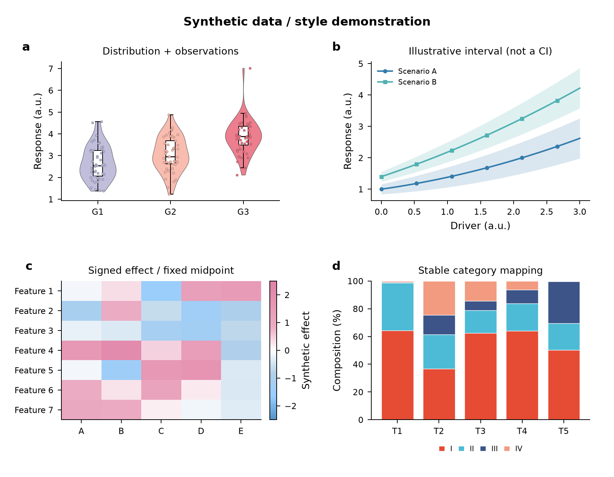
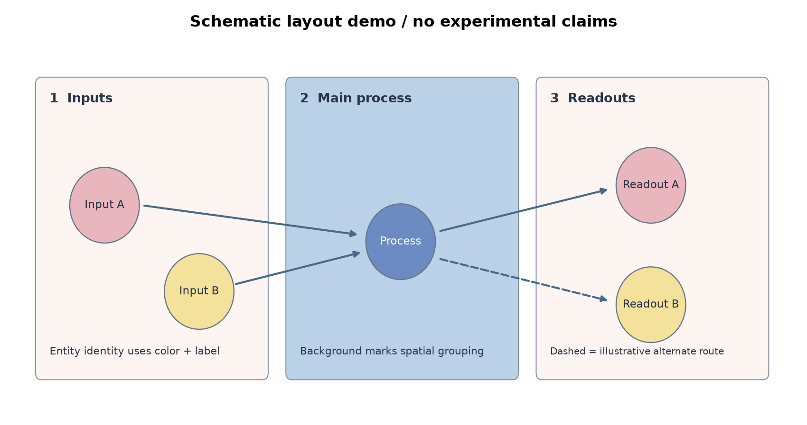
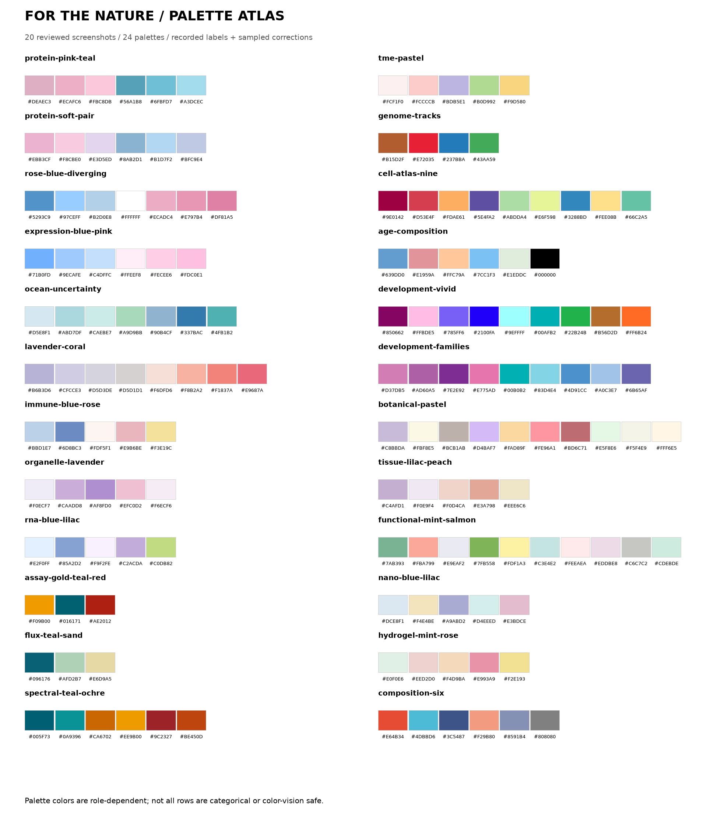

# Figure for the nature

A Codex skill for scientific visualization, publication figures, color palettes, multi-panel layouts, statistical plots and biological mechanism diagrams. Built from visual analysis of 20 reference screenshots, with 24 palettes and 150 documented color positions.

[Download ZIP](https://github.com/wddcg6-crypto/for-the-nature/archive/refs/heads/main.zip) · [Skill entry](nature-figure-style/SKILL.md) · [Releases](https://github.com/wddcg6-crypto/for-the-nature/releases)

Based on multiple scientific research drawings as references, the color schemes, layouts, visual hierarchies and applicable boundaries are extracted one by one. It includes 24 color palettes, 150 color positions, and supports data charts and biological mechanism charts.

这是一套可检索的绘图经验库。绘图时，Codex 读取相关图例分析并选择适配当前数据的样式。





## 安装与调用

将整个 `nature-figure-style` 文件夹复制到 Codex 的个人技能目录 `~/.codex/skills/`。保留目录内部结构，不能只复制 `SKILL.md`。

下载并解压后，可在仓库根目录运行：

```bash
mkdir -p ~/.codex/skills
cp -R nature-figure-style ~/.codex/skills/
```

若目标目录已有同名 skill，先比较差异，再更新相应文件，避免直接覆盖个人修改。新会话中可明确调用：

```text
使用 $nature-figure-style，根据这份 CSV 绘制 2×2 论文图：
包含分布、带置信区间的趋势、热图和组分比例。
请选择相关参考图，保持组别颜色一致，输出绘图代码、SVG、PDF 和 PNG。
```

```text
使用 $nature-figure-style，把我提供的材料合成与细胞作用流程画成机制图。
参考 IMG_3045/3047 的分层布局，采用蓝紫浅色系。
先核对机制关系，再生成可编辑标签和矢量图。
```

也可以指定 `IMG_3031`、色板 ID、输出尺寸或已有期刊模板。你的明确要求优先。

## 内容

| 路径 | 用途 |
|---|---|
| `nature-figure-style/SKILL.md` | Codex 入口、任务路由与关键边界 |
| `references/image-catalog.md` | 全部 20 张图逐图分析，含可迁移规则和限制 |
| `references/design-rules.md` | 色彩语义、面板、字体、线条、机制图规则 |
| `references/palettes.md` | 24 套色板、色号和适用角色 |
| `references/corpus.json` | 20 个文件哈希/尺寸、150 个色位、取色证据 |
| `references/rendering.md` | Python/R 用法、导出与视觉检查 |
| `scripts/figure_style.py` | 色板查询、Matplotlib 样式、色板预览与原创演示 |
| `scripts/audit_corpus.py` | 数据完整性检查及可选本地原图复核 |
| `examples/` | 使用工具生成并视觉检查的演示图；均不是真实实验结果 |

上表中的 `references/`、`scripts/` 均位于 `nature-figure-style/` 内。安装 skill 不需要根目录示例图；skill 的运行资源都在自身目录中。

## 直接使用工具

查询色板仅需 Python 标准库。生成预览和示例需要安装绘图依赖：

```bash
python -m pip install -r requirements.txt
python nature-figure-style/scripts/figure_style.py list
python nature-figure-style/scripts/figure_style.py palette composition-six
python nature-figure-style/scripts/figure_style.py preview --output examples/palette-atlas
python nature-figure-style/scripts/figure_style.py demo --output examples/style-demo
python nature-figure-style/scripts/audit_corpus.py
```



## 分析方法与可复核性

图片逐张查看，没有只按文件名分类。对于清晰可读的 HEX 标注，保留其文字值；对于文字被遮挡的色位，用色块中心 13×13 像素逐通道中位数采样。JSON 同时记录标注、采样、坐标和采用值。解码/压缩/色彩管理会产生差异，采样不等于原始矢量稿色值。

特别记录了 IMG_3048 的薄荷色块误标：截图文字为 `#EEE6C6`，色块采样为 `#E0F0E6`，本库的机制图色板采用后者。IMG_3042 的绿色标注与色块也有较大差异，两种值均保留，默认采用清晰的标注值。

字体/线宽/毫米尺寸是新图实现起点，无法从截图精确反推原论文参数。截图的文献信息未外部核验；本库不把整个收藏都归为 Nature 原始图片。

## 本地原图与公开发布

本地 skill 的 `.private-reference/` 保存原始 20 张 WEBP，供 Codex 按需打开复核；该目录已加入 `.gitignore`，**公开 ZIP 和 Git 跟踪内容不包含原图**。公开版本可独立使用文字分析和色板。

需要在自己的电脑恢复私有原图时，将原文件放入该目录，或直接通过原目录核验：

```bash
python nature-figure-style/scripts/audit_corpus.py --source-dir '/path/to/for the nature'
```

本项目原创说明、代码与演示采用 MIT 许可；第三方参考图片不在该授权范围内。公开仓库：[wddcg6-crypto/for-the-nature](https://github.com/wddcg6-crypto/for-the-nature)。其他人可下载 ZIP 或克隆后安装。不要用包含私有目录的全目录压缩包发布原图。

## 验证记录

2026-10-20 在 Python 3.12 / Matplotlib 3.11.2 环境完成：

- Codex skill 结构验证通过；20 张原图 SHA-256、尺寸与已记录色块取样复核通过。
- 去掉私有原图并搬到临时目录后，色板查询和数据完整性检查仍可运行。
- 验证了非法色板/超额分类请求的报错、绘图样式上下文恢复、内部文档链接与 SVG 画布尺寸/可编辑文字。
- 打开统计图、机制布局和色板图谱检查，修复标题间距与边框裁切，重新导出 SVG/PDF/PNG。

演示使用固定随机种子的模拟数据；机制示例仅演示分区和箭头布局。R 读取示例尚未在本机执行，未验证任一真实研究数据的统计流程。
